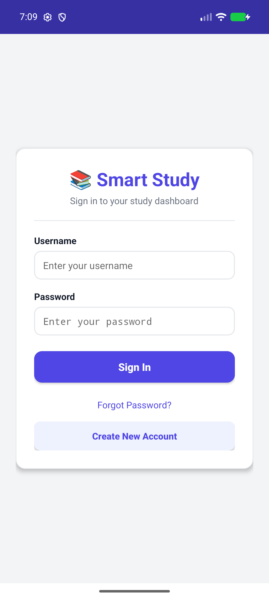
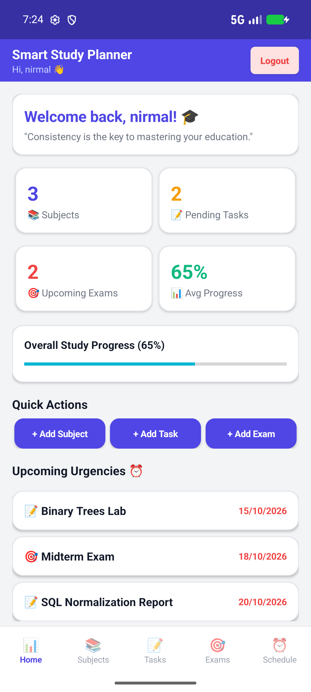
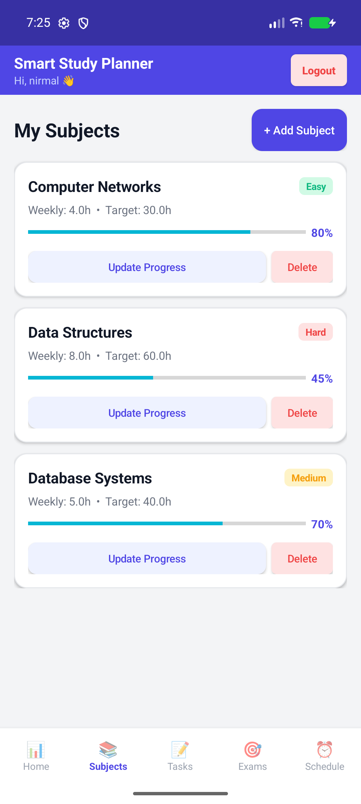
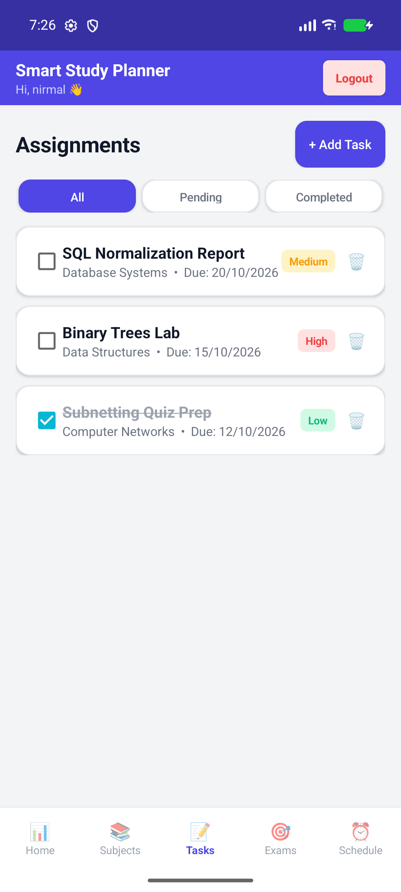
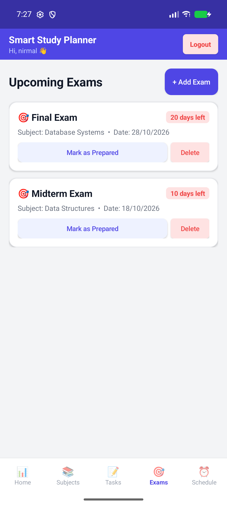
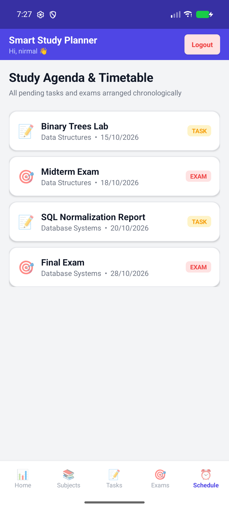

# 📚 Smart Study Planner

A comprehensive study planning and academic management application for students, available as both a **Java Desktop Application** and a **Native Android Mobile App (APK)**.

---

## 📱 Mobile App (Android APK)

The mobile version provides a complete, modern Material Design interface with offline SQLite database support.

### 📥 Download & Install
* **Android APK:** [`SmartStudyPlanner.apk`](SmartStudyPlanner.apk)
* Compatible with Android 8.0+ (API 26 to 34+ / Android 14 & 15).

```bash
# Install directly via ADB:
adb install -r SmartStudyPlanner.apk
```

### 🖼️ Screenshots

| Login & Authentication | Student Dashboard |
|:---:|:---:|
|  |  |

| Subject Management | Tasks & Assignments |
|:---:|:---:|
|  |  |

| Exams & Countdowns | Chronological Schedule |
|:---:|:---:|
|  |  |

---

## 💻 Desktop App (Java Swing)

The desktop edition runs on macOS, Windows, and Linux using Java SE.

### 📥 Download & Run
* **Executable JAR:** [`SmartStudyPlanner.jar`](SmartStudyPlanner.jar)

```bash
# Run the Desktop App:
java -jar SmartStudyPlanner.jar
```

---

## ✨ Features

* **🔐 Authentication & Security:** User registration, password hashing (SHA-256), and security recovery questions for password resets.
* **📊 Dashboard Analytics:** Overview stat cards tracking subjects, pending tasks, upcoming exams, and overall study progress percentage.
* **📚 Subject Management:** Set weekly hour goals, target study hours, difficulty ratings (*Easy*, *Medium*, *Hard*), and log study progress.
* **📝 Tasks & Assignments:** Track homework and assignments by due date and priority (*High*, *Medium*, *Low*) with interactive completion checkboxes and filtering.
* **🎯 Exams & Countdown:** Track exam dates with real-time countdown badges (*"X days left"*).
* **⏰ Unified Study Agenda:** Automatically compiles all upcoming tasks and exams into a chronological study timetable.
* **💾 Offline Persistence:** High-performance local storage (SQLite on Android, structured data on Desktop).

---

## 🛠️ Building From Source

### Rebuilding the Android APK
```bash
./android/build_apk.sh
```

### Compiling Desktop JAR
```bash
javac -d out src/Main.java $(find src -name "*.java")
jar cfe SmartStudyPlanner.jar Main -C out .
```
